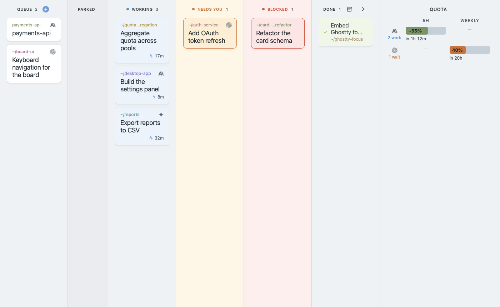
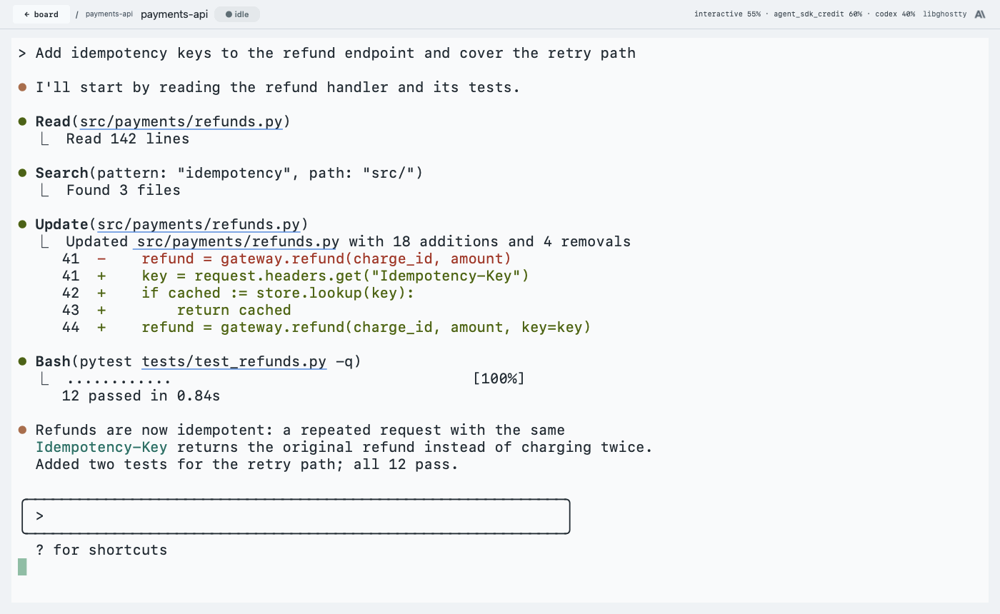

<p align="center">
  
</p>

<h1 align="center">Sich</h1>

<p align="center"><strong>Mission control for parallel agentic coding sessions</strong></p>

<p align="center">
  <a href="https://github.com/roman-romanov-o/sich/actions/workflows/ci.yml"></a>
  <a href="https://github.com/roman-romanov-o/sich/actions/workflows/codeql.yml"></a>
  <a href="https://scorecard.dev/viewer/?uri=github.com/roman-romanov-o/sich"></a>
  <a href="https://github.com/roman-romanov-o/sich/releases/latest"></a>
  <a href="LICENSE"></a>
</p>

Sich is a native macOS app for running many coding agents (Claude Code, Codex,
Cursor, Antigravity, Gemini CLI) at once without losing track of them. It is a kanban board where
every card **is** a live terminal session — Sich embeds
[libghostty](https://ghostty.org) and becomes the terminal, so it reads agent
state first-hand instead of scraping someone else's window.





<sub>Screenshots use synthetic demo data — regenerate with
`app/scripts/readme-screenshots.sh`.</sub>

## What it does

- **Board of live sessions** — cards move between columns (working / waiting on
  you / done) driven by real agent lifecycle hooks, not heuristics. A "who
  needs me" count surfaces the sessions blocked on your input.
- **Embedded terminal** — click a card to drill into its session: a real PTY
  rendered by libghostty-vt in-process. Scrollback, paste, themes, resize.
- **Quota-aware capacity** — live gauges for the two Anthropic pools
  (interactive subscription vs. API credits), plus Codex/Gemini, so you know
  how much agent capacity you actually have before starting more work.
- **Pool firewall** — managed sessions are interactive-only by construction;
  Sich structurally refuses to spawn headless `claude -p` and spend API credits
  on your behalf.
- **Remote sessions** — attach tmux sessions on remote boxes over SSH as
  first-class cards.

## Install

Download the latest `Sich.app` from
[**Releases**](https://github.com/roman-romanov-o/sich/releases)
— the app ships as a release artifact, never as a binary in this repository.

The bundle is currently unsigned; on first launch either right-click →
**Open**, or clear the quarantine flag:

```bash
xattr -dr com.apple.quarantine /Applications/Sich.app
```

Requires macOS 14 or later. The prebuilt app is a universal binary — it runs on
both Apple silicon and Intel Macs.

## Build from source

The one non-obvious prerequisite is the vendored **libghostty-vt** static
archives, which are too large to track in git. Rebuild them once with Zig
**0.15.2** on PATH (pins and details in
[`app/Frameworks/README.md`](app/Frameworks/README.md)), then build the app:

```bash
app/scripts/build-ghostty-vt.sh   # once per clone
cd app
./make-app.sh            # → build/Sich.app
./make-app.sh --install  # …and copy to /Applications
```

## Develop

```bash
cd app
swift build
swift test        # full suite
swift run sich    # run the board from source
./dev.sh          # DEBUG hot reload via InjectionIII
```

A small residue of repo-level Python tests runs with `uv sync --extra dev &&
uv run pytest`.

## Security and trust

Every change lands through a protected `main` that requires the CI, CodeQL and
forwarder checks; the workflows run on GitHub-hosted runners with SHA-pinned,
read-only-token actions; CodeQL scans the Swift code and the workflows
themselves, and the OpenSSF Scorecard badge above tracks the rest. The Swift
package has no third-party dependencies; the one vendored library,
libghostty-vt, is built in CI from a pinned revision. Releases carry signed
build provenance you can check with `gh attestation verify` — see
[`SECURITY.md`](SECURITY.md) for the exact commands and for what the app
touches on your machine.

## Learn more

- [`docs/PRODUCT.md`](docs/PRODUCT.md) — product thesis and constraints
- [`docs/OPERATING-RULES.md`](docs/OPERATING-RULES.md) — pace & attention rules (Rule 1 enforced in-app)
- [`docs/ARCHITECTURE.md`](docs/ARCHITECTURE.md) — how the pieces fit
- [`app/README.md`](app/README.md) — Swift package layout and dev workflow
- [`CONTRIBUTING.md`](CONTRIBUTING.md) — how to build, test, and send changes

## License

[MIT](LICENSE)
