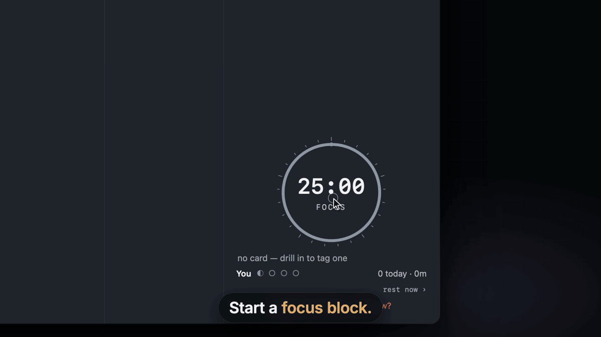
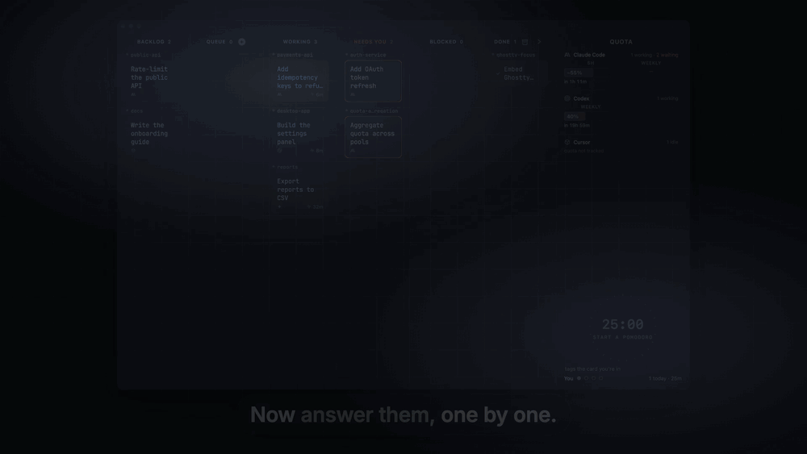
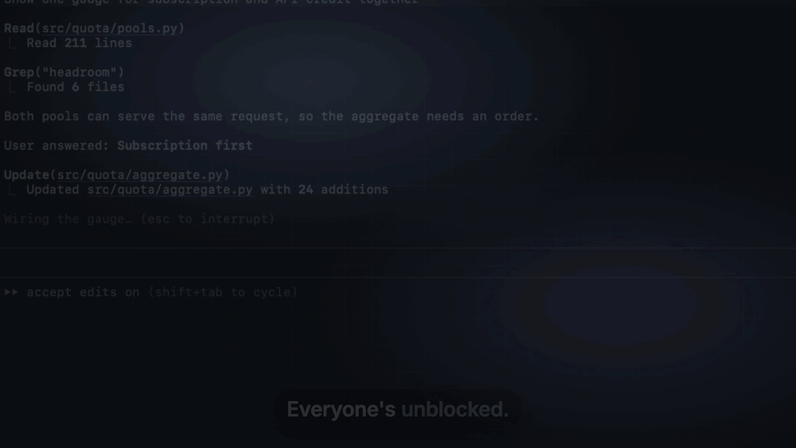
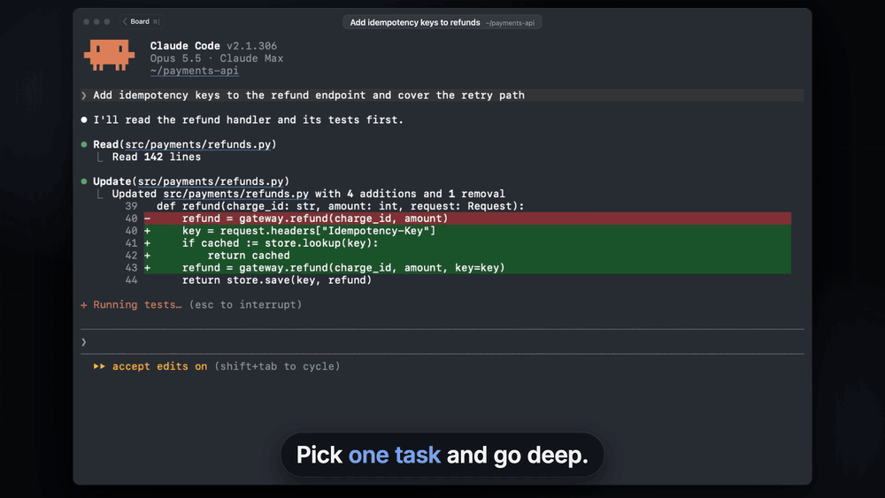
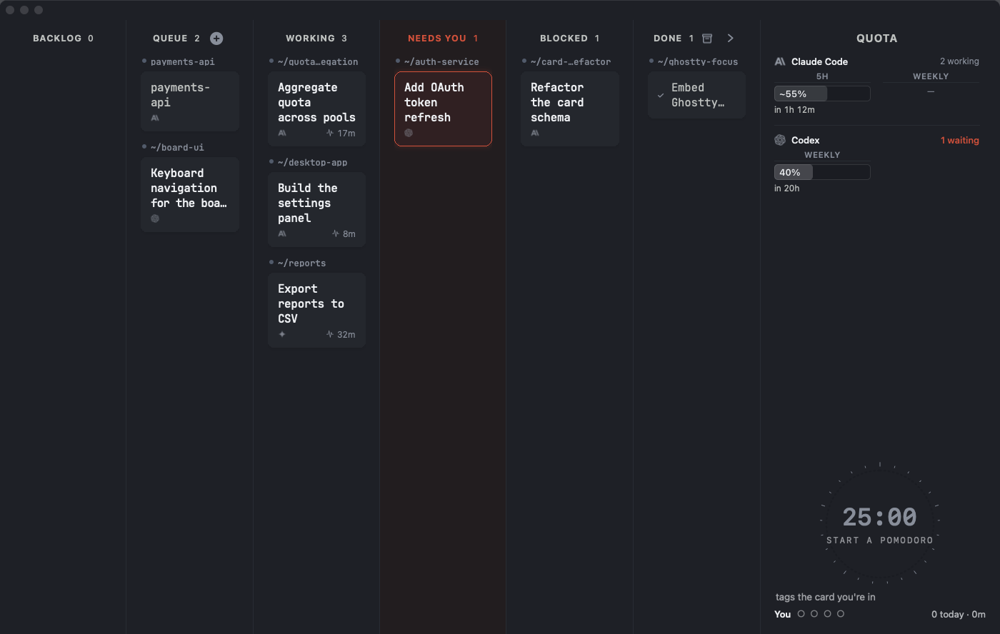
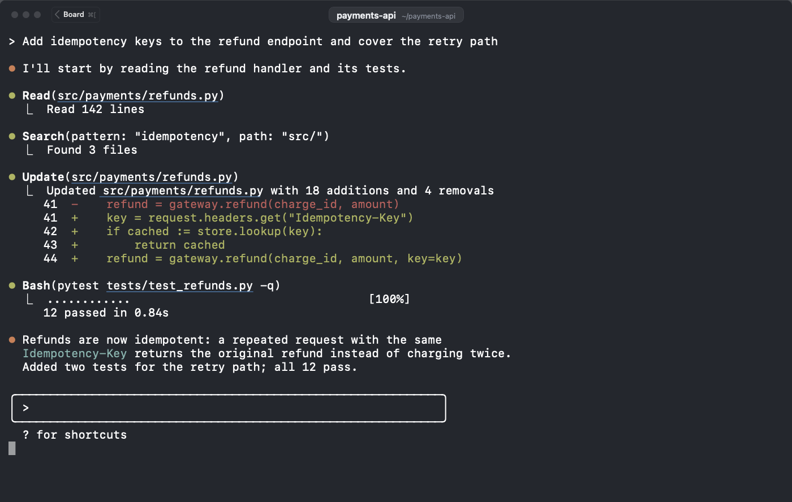

<p align="center">
  
</p>

<h1 align="center">Sich</h1>

<p align="center"><strong>A calm kanban board for your coding agents</strong></p>

<p align="center">
  <a href="https://github.com/roman-romanov-o/sich/actions/workflows/ci.yml"></a>
  <a href="https://github.com/roman-romanov-o/sich/actions/workflows/codeql.yml"></a>
  <a href="https://scorecard.dev/viewer/?uri=github.com/roman-romanov-o/sich"></a>
  <a href="https://github.com/roman-romanov-o/sich/releases/latest"></a>
  <a href="LICENSE"></a>
</p>

<p align="center">
  
</p>

<p align="center"><b>Every agent on one board. One glance tells you who needs you.</b><br>
<sub><a href="assets/promo.mp4">▶ Watch the full one-minute tour</a></sub></p>

Sich is a native macOS app for working alongside many coding agents (Claude Code,
Codex, Cursor, Antigravity, Gemini CLI) without burning out. It gives the work a
shape: a kanban board where every card **is** a live terminal session and moves
on its own as the agent works, waits for you, or finishes — so you stop
tab-hopping between a dozen sessions. A built-in pomodoro holds the agents'
questions while you focus on one thing.

## Why Sich

Starting five agents is easy. Keeping your head while five agents interrupt you
is not: every session pulls at you, every question feels urgent, and by the
afternoon you have context-switched all day and finished nothing yourself. Sich
puts structure between you and that noise.

| | |
|---|---|
| 🗂️ **A board that keeps the shape of your day** | BACKLOG, QUEUE, WORKING, NEEDS YOU, DONE: the backlog keeps tomorrow's tasks off today's lanes. One glance tells you where everything is, so you don't have to keep it in your head. |
| 🔴 **Never miss a question** | Cards move between QUEUE, WORKING, NEEDS YOU and DONE from the agents' own lifecycle hooks, not screen scraping. Outside a focus block, the moment an agent stops to ask, its card turns red and the NEEDS YOU count tells you how many are waiting. |
| 🍅 **Focus blocks, not firefighting** | Start a pomodoro on the card you are working. While it runs, agents that stop to ask something are held: no alert, no red lane pulling at you, just a quiet "2 will need you after this pomodoro". The minutes are logged against the task you were on. |
| 🌿 **Real breaks** | When the timer ends the board dims behind a breathing break screen, and the agents keep working underneath. A reply you are halfway through typing holds the break until you press ↵. |
| 📋 **Questions come back as one list** | When the break is over, the held questions appear together. Pick one and the next pomodoro starts on it, so you answer agents one at a time instead of all at once. |
| ⛽ **Know your capacity before you start** | Live quota gauges for your Claude subscription, API credits, Codex and more, each with its reset time. You decide whether to start agent number six before you run out mid-task, not after. |
| 🧱 **No surprise API bills** | Sich only runs interactive sessions. It structurally refuses to spawn headless `claude -p`, so it never spends API credits on your behalf. |
| 🌍 **Local and remote side by side** | Attach a tmux session on any SSH host as a card: the agent's hooks are relayed back, so a remote card moves through the columns like a local one. Windows hosts work too, through psmux. |
| ♻️ **Sessions survive restarts** | Quit the app and reopen it: cards come back and resume their conversations. A DONE card closes its terminal to save resources and can be revived later. |
| ⌨️ **Keyboard-first** | ⌘N opens a launcher (folder → agent → go), ⌃Tab switches tasks with NEEDS YOU first, ⌘[ returns to the board. |

## A closer look

### ⌃Tab to whoever needs you

Hold ⌃ and tap Tab for a switcher of every live task, NEEDS YOU first. Release and you land in that agent's terminal with its question on screen: answer it, ⌃Tab to the next one.

<p align="center"></p>

### Nobody waiting? Take the next task

Once NEEDS YOU is empty, the board points you at the BACKLOG. Click a parked task and Sich launches its agent in that project, so the backlog drains one deliberate pick at a time.

<p align="center"></p>

### The card is the terminal

Click a card and you are in the real session: libghostty rendering in-process, box-drawing and block art drawn edge to edge like Ghostty, pixel-smooth scrollback at your display's refresh rate, paste, themes, and ⌘↑ / ⌘↓ to jump between your own prompts. No second terminal app, and no window juggling.

<p align="center"></p>

Sich is native Swift and AppKit with no Electron and no third-party Swift
dependencies. It is MIT licensed, needs no account, and sends nothing anywhere
except your own usage queries to the providers.

<details>
<summary>Screenshots</summary>





</details>

<sub>The video and screenshots use synthetic demo data. Regenerate them with
`app/scripts/promo-footage.sh` plus the Remotion project in [`promo/`](promo/README.md),
and `app/scripts/readme-screenshots.sh`.</sub>

## Install

```bash
brew install --cask roman-romanov-o/tap/sich
```

Or download `Sich-vX.Y.Z-universal.dmg` from the latest
[**release**](https://github.com/roman-romanov-o/sich/releases/latest), open it
and drag Sich to Applications. The app is signed with a Developer ID and
notarized by Apple, so it opens like any other Mac app.

Requires macOS 14 or later. The prebuilt app is a universal binary — it runs on
both Apple silicon and Intel Macs.

## Build from source

The one non-obvious prerequisite is the vendored **libghostty-vt** static
archives, which are too large to track in git. Rebuild them once with Zig
**0.15.2** on PATH (pins and details in
[`app/Frameworks/README.md`](app/Frameworks/README.md)), then build the app:

```bash
app/scripts/build-ghostty-vt.sh   # once per clone
cd app
./make-app.sh            # → build/Sich.app
./make-app.sh --install  # …and copy to /Applications
```

## Develop

```bash
cd app
swift build
swift test        # full suite
swift run sich    # run the board from source
./dev.sh          # DEBUG hot reload via InjectionIII
```

A small residue of repo-level Python tests runs with `uv sync --extra dev &&
uv run pytest`.

## Security and trust

Every change lands through a protected `main` that requires the CI, CodeQL and
forwarder checks; the workflows run on GitHub-hosted runners with SHA-pinned,
read-only-token actions; CodeQL scans the Swift code and the workflows
themselves, and the OpenSSF Scorecard badge above tracks the rest. The Swift
package has no third-party dependencies; the one vendored library,
libghostty-vt, is built in CI from a pinned revision. Releases carry signed
build provenance you can check with `gh attestation verify` — see
[`SECURITY.md`](SECURITY.md) for the exact commands and for what the app
touches on your machine.

## Learn more

- [`docs/PRODUCT.md`](docs/PRODUCT.md) — product thesis and constraints
- [`docs/OPERATING-RULES.md`](docs/OPERATING-RULES.md) — pace & attention rules (Rule 1 enforced in-app)
- [`docs/ARCHITECTURE.md`](docs/ARCHITECTURE.md) — how the pieces fit
- [`app/README.md`](app/README.md) — Swift package layout and dev workflow
- [`CONTRIBUTING.md`](CONTRIBUTING.md) — how to build, test, and send changes

## License

[MIT](LICENSE)
